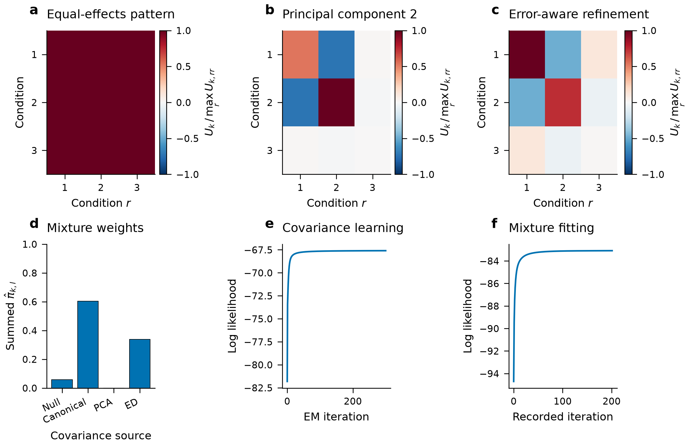

# JointShrink

Multivariate adaptive shrinkage uses shared patterns across conditions to
estimate effects and their uncertainty. JointShrink provides the Gaussian
summary-statistic method of [Urbut et al. (2019)](https://doi.org/10.1038/s41588-018-0268-8)
in Python, together with a native multivariate Student-t likelihood and direct
outcome-regression extensions.

```shell
pip install jointshrink
```

| Analysis | Start with |
| --- | --- |
| Supplied effects and standard errors | [Gaussian summaries](tutorials.md#fit-supplied-patterns) |
| Heavy-tailed summary errors | [Student-t summaries](tutorials.md#fit-student-t-summary-errors) |
| Learn shared patterns | [Covariance learning](tutorials.md#learn-sharing-patterns) |
| Outcomes and predictors | [Direct regression](tutorials.md#fit-outcomes-and-predictors) |
| Event times, categories or excess zeros | [Regression families](api.md#regression-fitting) |
| Missing summary conditions or larger inputs | [Prior reuse and batches](tutorials.md#reuse-a-prior) |
| Function arguments and result methods | [Grouped API](api.md) |



The [tutorials](tutorials.md) use constructed inputs. Gaussian summary inference
conditions on fitted prior parameters; direct regression uses posterior
sampling. Numerical agreement checks do not establish interval calibration or
convergence in every analysis. See [methods and limits](methods.md).

[Installation](installation.md) · [Reference manual](manual/reference.md) · [Numerical comparisons](reference-checks.md)
