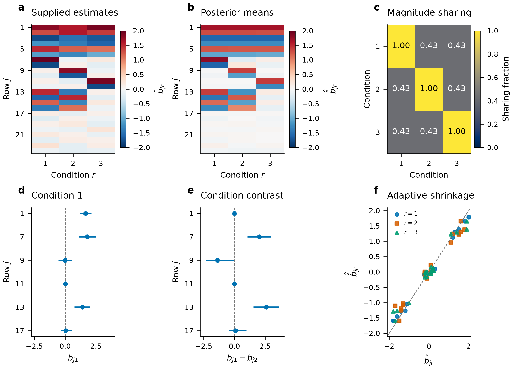
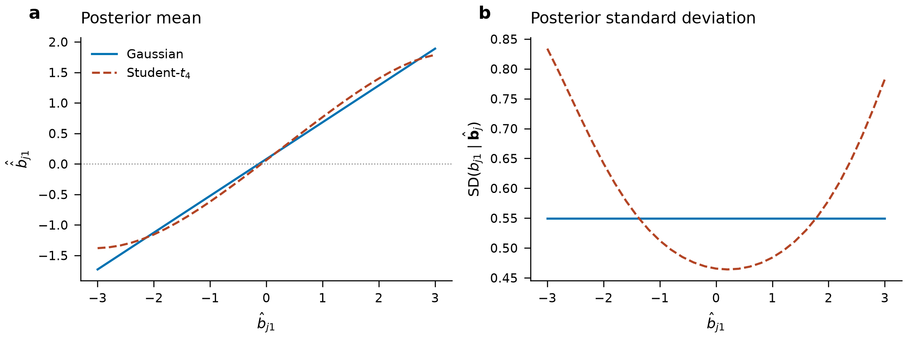
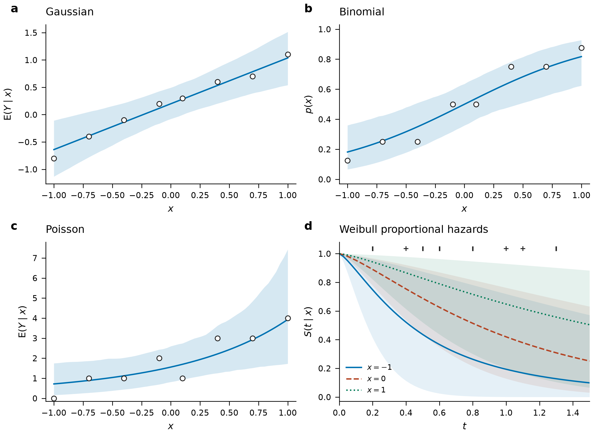

# Overview

**Author:** Nilson Chapagain, Texas A&M University
**Email:** nchapagain@tamu.edu

JointShrink estimates effects jointly across conditions using Gaussian mixture priors. The Gaussian summary-statistic method follows [Urbut et al. (2019)](https://doi.org/10.1038/s41588-018-0268-8). Separate extensions support native multivariate Student-$t$ summary likelihoods and direct regression from outcomes and predictors.

| Input and model | Fitting method |
| --- | --- |
| Effect estimates and standard errors; Gaussian errors | Multivariate adaptive shrinkage (MASH), with empirical-Bayes mixture weights |
| Effect estimates and Student-$t$ scale matrices | Native multivariate $t$ likelihood, numerical quadrature and empirical-Bayes mixture weights |
| Outcomes and predictors | Gaussian-mixture coefficient prior with sampled coefficients and mixture weights; Gaussian, binomial, count, categorical and survival models |

The direct-regression extensions use a different posterior model from Gaussian MASH. Their residual scales, dispersion, ordinal thresholds and Weibull shape are supplied and held fixed.

# Installation

Python 3.10 or later is required.

```shell
pip install jointshrink
```

For Matplotlib plots and pandas tables:

```shell
pip install "jointshrink[plot,table]"
```

## From GitHub

```shell
python -m pip install "git+https://github.com/nilson01/jointshrink.git@main"
```

## From a local checkout

Run this command in the directory containing `pyproject.toml`:

```shell
python -m pip install .
```

NumPy and SciPy are required. Plots require Matplotlib; `to_dataframe()` requires pandas. Analysis does not require R.

## Gaussian example

```python
from jointshrink import set_data, fit

data = set_data([[1.2, 1.0], [-0.8, -1.0], [0.1, -0.2]], 0.5)
result = fit(data, scales=[0.25, 0.5, 1.0, 2.0])
print(result.format_summary())
```

# Worked examples

## Gaussian fitting with specified covariance patterns

Each row contains estimates of one effect across conditions; columns identify conditions. The following values are constructed examples.

```python
import numpy as np
from jointshrink import set_data, fit, canonical_covariances

effects = np.array([
    [1.2, 1.0], [-1.1, -0.9], [0.1, -0.2],
    [1.5, 0.1], [-0.1, 1.4], [0.2, 0.1],
])
data = set_data(effects, 0.5, condition_names=["A", "B"])
patterns = canonical_covariances(data)
result = fit(data, patterns, scales=[0.25, 0.5, 1.0, 2.0])
print(result.format_summary())
print(result.posterior_mean)
print(result.interval(level=0.95))
```

`posterior_mean` estimates each effect after shrinkage. `interval()` returns equal-tailed marginal credible intervals. Both condition on the fitted covariance patterns and mixture weights. Check `result.diagnostics["converged"]` before interpreting a fit.

## Covariance-pattern estimation

Strong rows help identify covariance patterns. Final mixture weights should instead use all rows or a representative training sample, because strong rows overrepresent large effects ([Urbut et al., 2019](https://doi.org/10.1038/s41588-018-0268-8)).

```python
from jointshrink import select_strong, cov_pca, cov_ed

strong = select_strong(data, z_threshold=2)
pca = cov_pca(data, n_components=2, subset=strong)
starts = {"PCA": pca["PCA_total"] + 0.1 * np.eye(data.n_conditions)}
learned = cov_ed(data, starts, subset=strong, maxiter=300)
patterns = {**canonical_covariances(data), **pca, **learned.covariances}
result = fit(data, patterns, scales=[0.25, 0.5, 1.0, 2.0])
print(learned.diagnostics["reason"])
```

Adding `0.1` makes this example's starting matrix positive definite; it is not a package default. Inspect the likelihood trace and stopping reason because covariance learning can reach a local optimum or its iteration limit.

## Contrasts and effect sharing

```python
contrast = result.contrast([[1, -1]], names=["A minus B"])
print(contrast.posterior_mean)
print(contrast.interval())
sharing = result.sharing(mode="magnitude", factor=0.5)
print(sharing["matrix"])
print(sharing["denominator"])
```

The contrast uses the joint posterior covariance. Magnitude sharing requires equal nonzero signs and posterior means within a factor of two. Each denominator counts rows with a selected error rate below the threshold in either condition. This proportion describes the fitted posterior means; it is not a posterior probability of sharing.

## Posterior inference with a fitted prior

```python
from jointshrink import fit_prior, save_prior, load_prior

prior = fit_prior(data, patterns, scales=[0.25, 0.5, 1.0, 2.0])
new_data = set_data([[0.8, np.nan], [-0.4, -0.6]], 0.5,
                    condition_names=["A", "B"])
new_result = prior.apply(new_data)
save_prior(prior, "prior.json")
restored = load_prior("prior.json")
for batch in restored.iter_apply(new_data, batch_size=128):
    print(batch.posterior_mean)
```

A missing effect estimate uses `NaN`; its standard error must still be finite and positive. The likelihood uses only the observed estimates and their sampling-covariance submatrix. The unobserved effect is inferred from the fitted prior and the observed effects. Retain the same condition order and EE/EZ scale; reuse holds patterns and weights fixed.

## Student-t summary models

```python
from jointshrink import set_data, fit_student_t

data_t = set_data([[1.2, 1.0], [-0.8, -1.0], [0.1, -0.2]], 0.5)
result_t = fit_student_t(data_t, df=4, scales=[0.25, 0.5, 1.0])
print(result_t.posterior_mean)
print(result_t.diagnostics["quadrature_converged"])
```

Here `0.5` is the square root of the Student-$t$ scale diagonal, not the error SD. The [native Student-t model](#native-student-t-summary-model) explains the distinction.

## Binomial regression

```python
import numpy as np
from jointshrink import fit_logistic_regression

X = np.array([[-1.5], [-1.0], [-0.2], [0.3], [0.8], [1.4]])
y = np.array([0, 0, 1, 0, 1, 1])
regression = fit_logistic_regression(X, y, seed=4)
print(regression.format_summary())
print(regression.diagnostics["split_rhat"])
probability = regression.predict(X, scale="probability")
```

This constructed binary example has one predictor and an intercept. The result contains posterior draws; inspect the [sampling diagnostics](#posterior-sampling-and-convergence-diagnostics) before interpretation. An estimated success probability differs from a sampled future binary outcome.

## Plotting and result export

```python
from jointshrink import plot_intervals, plot_sharing

ax = plot_intervals(result, condition="A")
ax.figure.savefig("intervals.png", dpi=300, bbox_inches="tight")
ax = plot_sharing(result)
records = result.to_records()
# With pandas installed:
table = result.to_dataframe()
```

Plot functions return Matplotlib axes and do not display or save figures automatically.



# Model illustrations



Both models use the same fixed prior and error covariance. For Student-$t_4$ errors, the scale matrix is half that covariance. The second supplied estimate stays at $0.5$ while the first varies. These are illustrations, not repeated-dataset comparisons. [Input values](../figures/extension-summary-inputs.csv) and [posterior summaries](../figures/extension-summary-values.csv) are available.



Each fit uses eight constructed observations, one predictor and two chains with 500 retained draws after 300 warmup iterations. Bands describe uncertainty in a conditional mean or survival probability, not future-outcome intervals. Gaussian residual SD is $0.4$, binomial trials are 8, Poisson exposure is 2, and Weibull shape is 1.3. [Inputs](../figures/extension-regression-inputs.csv) and [predictions](../figures/extension-regression-predictions.csv) retain the plotted values.

# Statistical models and inference

## Gaussian summary model

Let $b_{jr}$ be effect $j$ in condition $r$, and let $\widehat b_{jr}$ and $\widehat s_{jr}$ be its estimate and standard error. The vector $b_j$ contains the true effects in $R$ conditions. Following equations (2)–(4) of [Urbut et al. (2019)](https://doi.org/10.1038/s41588-018-0268-8),

$$
p(\widehat b_j\mid b_j,V_j)=N_R(\widehat b_j;b_j,V_j),
$$

$$
p(b_j\mid\pi,U)=\sum_{k=1}^{K}\sum_{l=1}^{L}\pi_{k,l}
N_R(b_j;0,\omega_l U_k).
$$

Here, $N_R$ denotes an $R$-dimensional normal distribution (a density when its covariance is positive definite), $V_j$ is the observation-error covariance, $U_k$ describes an effect-sharing pattern, $\omega_l$ multiplies its covariance, and $\pi_{k,l}$ is a mixture proportion. The proportions are nonnegative and sum to one. The covariance patterns are positive semidefinite (PSD). Consequently,

$$
p(\widehat b_j\mid\pi,U,V_j)=\sum_{k=1}^{K}\sum_{l=1}^{L}\pi_{k,l}
N_R(\widehat b_j;0,\omega_l U_k+V_j).
$$

Observation-error matrices must be positive definite. Prior patterns may be singular, including a point mass at zero. Rows are treated as independent when fitting the mixture likelihood.

## Effect scales and observation errors

`alpha=0` fits exchangeable effects (EE): the common prior describes effects in their original units, independently of the supplied standard errors. `alpha=1` fits exchangeable Z scores (EZ): the common prior instead describes effects divided by their standard errors. EZ fitting divides both the estimates and their sampling errors by those standard errors. Posterior summaries are returned in the original effect units. Original-scale log densities include the transformation Jacobian for observed coordinates.

With supplied standard errors and error correlation $C$, the model uses $V_j=S_j C S_j$, where $S_j$ has diagonal entries $\widehat s_{jr}$. `error_covariance` supplies $V_j$ directly and replaces both standard errors and correlation inputs. `estimate_null_correlation` estimates correlation from complete rows with all absolute Z scores below a threshold; selection can bias this estimate.

Missing effect estimates use `NaN`. Their standard errors remain required, including under EZ, to define the output scale. Likelihoods use observed-condition blocks of $V_j$; posterior inference can include unobserved conditions. This does not correct informative missingness. PCA and extreme-deconvolution learning require complete selected rows.

## Covariance patterns and scale grids

Canonical patterns describe effects that, within a Gaussian component, are uncorrelated, nonzero in one condition, equal across conditions, or positively correlated. A mixture of diagonal-covariance components need not make the effects marginally independent. Principal component analysis (PCA) supplies candidate directions from strong rows. Its default uses an uncentered singular value decomposition (SVD) of working effect estimates, following the R helper. Centered Z-score PCA requires `alpha=1` and `center=True`.

Extreme deconvolution fits a zero-mean Gaussian mixture while accounting for observation error, following the noisy-mixture approach used by [Urbut et al. (2019)](https://doi.org/10.1038/s41588-018-0268-8). The algorithm can have local optima. An exactly singular start cannot expand its support under unconstrained expectation–maximization (EM) updates. `ridge` sets an explicit eigenvalue floor; `rank` limits component rank. Projected proposals are accepted only when the observed likelihood does not decrease. A rejected proposal and an iteration limit are reported separately from convergence.

Patterns are normalized by their largest diagonal entry unless `normalize=False`. Python `scales` contains standard-deviation multipliers: their squares are the paper's covariance multipliers $\omega_l$. The automatic grid spans small working standard errors through the largest observed working effect. Use an explicit grid when matching another implementation.

## Mixture-weight estimation and posterior uncertainty

`fit_prior` estimates mixture weights using the supplied rows. `null_weight=1` uses maximum likelihood; larger values add a log-weight penalty favoring the global-null component. A penalized fit requires that component. Inspect the convergence flag, objective trace and Karush–Kuhn–Tucker (KKT) residual in the fitted diagnostics. A small KKT residual checks the weight-optimization conditions, not the observation model.

Posterior means, credible intervals and sign probabilities condition on the selected patterns and fitted weights. They do not include all uncertainty from learning those quantities. For each effect and condition,

$$
\mathrm{lfdr}_{jr}=\Pr(b_{jr}=0\mid\widehat b_j),
\qquad
\mathrm{lfsr}_{jr}=\min\{\Pr(b_{jr}\leq0\mid\widehat b_j),
\Pr(b_{jr}\geq0\mid\widehat b_j)\}.
$$

The local false sign rate includes zero mass in either possible sign error. `lfdr` is the marginal posterior probability of an exact zero. `joint_null_probability` concerns the entire row being zero. The displayed probabilities hold fitted prior parameters fixed. These probabilities depend on the observation model and fitted prior.

## Memory management

A full result stores component-specific posterior covariance matrices. Storage therefore grows with rows × components × conditions squared. The kernel rejects a posterior-component allocation above 256 MiB; total process memory can be higher. Use `fit_prior` for weight fitting and `prior.iter_apply(data, batch_size=...)` for ordered posterior batches. Scoring and prior fitting use likelihood-only calculations. Reduce the batch size when the number of conditions or components is large.

Retain the original condition order when reusing a prior: columns are matched positionally. `prior.apply` is the Gaussian summary interface; native $t$ reuse requires `apply_student_prior` or `StudentTResult.shrink`. FLASH/UDR covariance learning and GPU fitting are not provided.

## Native Student-t summary model

For estimates with heavier-tailed errors, the native $t$ route retains the Gaussian mixture prior but changes the observation model. Here $V_j$ denotes a positive-definite error **scale matrix**, rather than the Gaussian sampling covariance. Let $\nu_j>0$ be the supplied degrees of freedom. The implementation uses

$$
\lambda_j\sim\mathrm{Gamma}(\nu_j/2,\mathrm{rate}=\nu_j/2),
\qquad
\widehat b_j\mid b_j,\lambda_j\sim N_R(b_j,V_j/\lambda_j).
$$

One precision $\lambda_j$ is shared across a row's observed conditions. This gives elliptical multivariate $t$ errors, rather than independent univariate $t$ errors. The scale convention follows [SciPy's multivariate $t$ definition](https://docs.scipy.org/doc/scipy/reference/generated/scipy.stats.multivariate_t.html). The error covariance is $\nu_j V_j/(\nu_j-2)$ only for $\nu_j>2$; it does not exist for $\nu_j\leq2$.

For this route, `error_covariance` supplies $V_j$, and `standard_errors` supplies its diagonal square roots when an explicit scale matrix is not supplied. These inputs are not error standard deviations under a finite-degree-of-freedom $t$ likelihood. EE/EZ transformations retain the same original-scale Jacobian as Gaussian MASH. Missing conditions use the observed block of $V_j$.

Integration over log precision produces a finite Gaussian-mixture approximation to the posterior. Increasing quadrature orders checks marginal log densities, first and second posterior moments, and CDFs at zero. Inspect `quadrature_converged` and `quadrature_relative_change`; an unmet tolerance produces a warning. These checks are not rigorous error bounds for every posterior quantile. Uncertainty remains conditional on supplied $V_j,\nu_j$ and fitted prior parameters.

## Regression models

Direct regression starts from outcomes, rather than estimates from an earlier analysis. Let $X$ contain $n$ observations and $p$ predictors, and let $D$ be the number of linear predictors needed by the likelihood. Each coefficient row $B_j\in\mathbb R^D$ has the same mixture prior. The covariance components describe relationships among its $D$ linear-predictor coefficients; mixture weights are shared across the $p$ predictor rows:

$$
B_j\mid c_j=k\sim N_D(0,\Sigma_k),\qquad
\Pr(c_j=k\mid\pi)=\pi_k,\qquad
\pi\sim\mathrm{Dirichlet}(a_1,\ldots,a_K).
$$

The fixed matrices $\Sigma_k$ include supplied covariance patterns and squared SD multipliers; a zero component is included when `point_mass=True`. `dirichlet` supplies positive concentrations $a_k$. Unlike `fit_prior`, this model samples $\pi$ rather than maximizing a marginal likelihood.

With intercept $\beta_{0r}$, supplied offset $o_{ir}$ and group effects $u_{g(i),qr}$, its linear predictor is

$$
\eta_{ir}=\beta_{0r}+\sum_{j=1}^p x_{ij}B_{jr}
 +\sum_{q=1}^Q z_{iq}u_{g(i),qr}+o_{ir}.
$$

Group terms are absent when `groups=None`. Intercepts have independent $N(0,5^2)$ priors; Cox models omit them. Inputs are not standardized automatically, so predictor and response units affect these priors. Use the same predictor order and preprocessing for fitting and prediction. Constant or aliased predictors can prevent separate coefficients from being identified by the likelihood, even with proper priors.

### Outcome distributions and link functions

Except for the single categorical or survival outcome, `y` can have shape `(n,R)`. Its columns are conditionally independent given their predictors and group effects. Shared coefficient or group priors do not provide a general residual covariance model. Missing raw outcomes and predictors are rejected.

Let $\mathrm{logit}^{-1}(x)=1/(1+e^{-x})$. For the negative binomial, NB2 denotes the variance convention given below. In count models, $e_{ir}>0$ is supplied exposure and $\mu_{ir}=e_{ir}\exp(\eta_{ir})$ is the mean of the underlying Poisson or NB2 count component. In zero-inflated and hurdle models, the overall response mean differs from $\mu_{ir}$.

| `family` | Likelihood and supplied quantities |
| --- | --- |
| `gaussian` | $y_{ir}\sim N(\eta_{ir},\sigma_{ir}^2)$; positive `sigma` fixed |
| `binomial` | $y_{ir}\sim\mathrm{Binomial}(m_{ir},\mathrm{logit}^{-1}(\eta_{ir}))$; integer `trials` supplies $m_{ir}$; binary outcomes use one trial |
| `poisson` | $y_{ir}\sim\mathrm{Poisson}(\mu_{ir})$ |
| `negative_binomial` | NB2 with mean $\mu_{ir}$ and variance $\mu_{ir}+\phi_{ir}\mu_{ir}^2$; positive `dispersion` supplies fixed $\phi_{ir}$ |
| `multinomial` | One category vector coded $0,\ldots,K-1$; $K-1$ logits with category $K-1$ as reference |
| `ordinal` | $\Pr(y_i\leq k\mid\eta_i)=\mathrm{logit}^{-1}(c_k-\eta_i)$ for $k=0,\ldots,K-2$; strictly ordered `thresholds` $c_k$ fixed |
| `cox` | Proportional hazards with Breslow tied-event partial likelihood; `event` and positive observed times required |
| `weibull` | Proportional hazards with baseline cumulative hazard $H_0(t)=t^a$; positive `shape` $a$ fixed |

Categorical models infer the category count from observed codes unless `n_categories` is supplied. Supply it when unobserved categories must be retained. Ordinal default thresholds are the logits of $1/K,\ldots,(K-1)/K$; they are not estimated. Increasing the ordinal predictor shifts mass toward larger category codes. This cumulative-link convention is described in the [statsmodels ordered-model reference](https://www.statsmodels.org/stable/generated/statsmodels.miscmodels.ordinal_model.OrderedModel.html).

### Zero-inflated and hurdle models

`zero_inflated_poisson`, `zero_inflated_negative_binomial`, `hurdle_poisson` and `hurdle_negative_binomial` use $2R$ linear predictors: count predictors first, then zero-probability logits. Write $\rho_{ir}$ for the inverse-logit of the second predictor and $f(y;\mu,\phi)$ for the Poisson or NB2 mass.

$$
\begin{aligned}
\Pr_{\mathrm{ZI}}(Y=0)&=\rho+(1-\rho)f(0),&
\Pr_{\mathrm{ZI}}(Y=y)&=(1-\rho)f(y),\quad y>0,\\
\Pr_{\mathrm{H}}(Y=0)&=\rho,&
\Pr_{\mathrm{H}}(Y=y)&=(1-\rho)\frac{f(y)}{1-f(0)},\quad y>0.
\end{aligned}
$$

Thus the zero-inflated mean is $(1-\rho)\mu$, while the hurdle mean is $(1-\rho)\mu/[1-f(0)]$. The zero logit has the same direction in both models: larger values increase zero probability. By default these fits use an identity covariance pattern for coefficients across the count and zero predictors; supplied patterns may express a chosen relationship.

### Survival models

Both survival families support right censoring and delayed entry with `0 <= entry < time`. The Cox risk set at event time $t$ uses $\mathrm{entry}_i<t\leq\mathrm{time}_i$, with Breslow handling of tied events. The coefficient posterior is proportional to the Cox partial likelihood times the specified priors; it does not come from a full event-time likelihood. Survival inference requires non-informative censoring conditional on the modeled predictors and group effects, and appropriate adjustment for delayed entry. Absolute survival uses a draw-specific Breslow baseline estimated from the training data; it propagates coefficient uncertainty but does not integrate separate baseline uncertainty. No-event data cannot supply an absolute baseline. [The statsmodels PHReg reference](https://www.statsmodels.org/stable/generated/statsmodels.duration.hazard_regression.PHReg.html) describes the corresponding right-censoring, entry and ties conventions. Weibull absolute survival instead depends on the supplied shape and parametric baseline. Competing risks, interval censoring and time-varying covariates are not included.

### Gaussian random effects

`groups` supplies one nonempty string label per observation. Without `random_design`, each group has a random intercept. A supplied `(n,Q)` design allows random slopes. Flattening each group's `(Q,D)` effects in row order gives

$$
\mathrm{vec}(u_g)\mid\tau^2\sim N_{QD}(0,\tau^2 A).
$$

`random_covariance` supplies the fixed positive-definite shape matrix $A$ of dimension `(Q*D,Q*D)`. The default is identity. `random_scale` supplies the common multiplier $\tau$; marginal group-effect SDs also depend on the diagonal of $A$. With `estimate_random_scale=True`, it sets the initial value and $\tau^2$ has an inverse-gamma prior with shape 2 and scale 1. Otherwise it stays fixed. This estimates one common scale, not an unrestricted random-effect covariance or general within-group residual correlation.

### Posterior sampling and convergence diagnostics

Regression uses Markov chain Monte Carlo (MCMC). It combines joint component/coefficient proposals from the current prior, elliptical slice updates within Gaussian components, and Dirichlet updates for mixture weights. Elliptical slice sampling follows [Murray, Adams and MacKay (2010)](https://proceedings.mlr.press/v9/murray10a.html). Component-changing proposals allow transitions between zero, singular and full-rank prior components. A failed slice-bracket search raises an error rather than accepting an approximate update.

Inspect coefficient traces, `split_rhat`, `effective_sample_size`, `constant_coordinates`, `prior_proposal_acceptance` and `component_switches`. The effective sample size is an autocorrelation estimate, not a rank-normalized bulk effective sample size. Constant coordinates have undefined diagnostics; a chain stuck at zero is not evidence of convergence. The coefficient diagnostics do not certify mixing for every group effect or mixture weight. Successful execution and multiple chains do not establish convergence or calibration.

# API reference

All functions below are imported from `jointshrink`. Summary arrays use effects × conditions, with `(n,d)` denoting rows × conditions in API shapes. Regression uses observations × predictors; $D$ denotes its number of linear predictors.

## Summary-statistic inputs

```text
set_data(effects, standard_errors=1, *, correlation=None,
         error_covariance=None, alpha=0, row_names=None, condition_names=None)
```

Returns `MashData`. `effects` has shape `(rows, conditions)` with at least two conditions; `NaN` marks a missing estimate. Standard errors broadcast to that shape and must be finite and positive. Correlation or explicit sampling covariance can be shared `(d,d)` or row-specific `(n,d,d)`. Explicit covariance cannot be combined with correlation or nondefault standard errors. `alpha` is `0` (EE) or `1` (EZ).

`MashData.subset(indices)` selects rows and preserves covariance and scale information. Input arrays are copied and exposed read-only. Row and condition names must be unique.

## Covariance patterns

| Function | Purpose and main controls |
| --- | --- |
| `canonical_covariances(data_or_dimension, *, methods=...)` | Identity, singletons, equal effects and simple heterogeneous patterns; `null` is also available |
| `validate_covariances(patterns, *, normalize=False)` | Named PSD matrices; maximum-diagonal normalization when requested |
| `select_strong(data, *, z_threshold=3)` | Row indices with an observed absolute Z score above the threshold |
| `cov_pca(data, n_components=2, *, subset=None, center=False)` | Rank-one PCs and their aggregate; complete selected rows required |
| `cov_ed(data, initial, *, subset=None, maxiter=200, tol=1e-6, ridge=0, rank=None)` | Error-aware covariance refinement; returns `CovarianceFit` |
| `make_scale_grid(data, *, factor=sqrt(2))` | Positive standard-deviation grid |
| `expand_covariances(patterns, scales, *, point_mass=True, normalize=True)` | Pattern × squared-scale combinations, deduplicated |
| `estimate_null_correlation(data, *, z_threshold=2, minimum_rows=None, regularization=0.05)` | Correlation of centered Z scores in rows below the absolute-Z threshold, shrunk toward identity |

`CovarianceFit` exposes `covariances`, `weights` and `diagnostics`. Its likelihood history and stopping reason distinguish convergence from an iteration limit or rejected proposal. `CorrelationEstimate` exposes `correlation`, selected `row_indices` and `diagnostics`.

## Gaussian fitting and prior reuse

```text
fit_prior(data, covariances=None, *, scales=None, normalize=True,
          point_mass=True, null_weight=1, initial_weights=None,
          maxiter=10000, tol=1e-8)
fit(data, covariances=None, **options)
```

Both functions fit mixture weights on all supplied rows. Omitted patterns use canonical covariances; omitted scales use the automatic grid. `scales` are SD multipliers. `fit_prior` returns `MashPrior` without allocating posterior moments. `fit` accepts the same options and returns `MashResult`. `Mash(covariances=None, **options).fit(data)` provides the configured-fit interface.

| Prior interface | Behavior |
| --- | --- |
| `MashPrior(covariances, names, weights, *, alpha=0, metadata=None)` | Construct a validated prior from already expanded covariance matrices and weights summing to one |
| `prior.apply(data)` or `apply_prior(data, prior)` | Condition on new rows without refitting |
| `prior.iter_apply(data, *, batch_size=128)` | Yield posterior batches in row order |
| `prior.score_samples(data)` or `score_samples(data, prior)` | Per-row log density in observed original units |

A reused prior requires the same condition order, number of conditions and EE/EZ scale. Stored prior covariances are already expanded; reuse does not apply a second scale grid.

## Posterior summaries

`MashResult` extends `PosteriorResult` with `prior`, `data`, `diagnostics`, per-row `log_likelihood`, and `log_bayes_factor`. The Bayes factor compares the fitted nonnull mixture, renormalized to nonnull weight one, against the global null. A result with no nonnull prior weight has log Bayes factor `-inf`.

| Property | Shape or meaning |
| --- | --- |
| `posterior_mean`, `posterior_sd` | `(n,d)` |
| `posterior_covariance` | `(n,d,d)` |
| `lfdr`, `lfsr` | `(n,d)`; marginal posterior null probabilities and local false sign rates |
| `probability_negative`, `probability_positive` | Strictly negative/positive posterior probability |
| `joint_null_probability` | `(n,)`; all conditions exactly zero |
| `row_names`, `condition_names`, `observed` | Labels and observed-coordinate mask |

| Method | Result |
| --- | --- |
| `cdf(value)` | Marginal probability of effect $\leq$ value |
| `quantile(probability)` | `(n,d)` for scalar probability; `(p,n,d)` for a vector |
| `interval(level=0.95)` | Equal-tailed intervals, `(n,d,2)` |
| `sample(size=1, seed=None)` | Conditional posterior draws, `(size,n,d)` |
| `contrast(coefficients, *, names=None)` | Joint posterior for linear contrasts; coefficients have shape `(contrasts,d)` |
| `significant(threshold=0.05, *, by="lfsr", any_condition=True)` | Row indices selected in any condition, or all when `False` |
| `sharing(*, factor=0.5, threshold=0.05, by="lfsr", mode="magnitude")` | Posterior-mean sharing matrix plus numerator, denominator and definition |
| `to_records(*, level=0.95)` | Long-form Python records |
| `to_dataframe(*, level=0.95)` | pandas table; requires pandas |
| `summary(*, threshold=0.05, by="lfsr")` | Compact dictionary |
| `format_summary(*, threshold=0.05, by="lfsr")` | Readable summary text |

`MashResult.shrink(data)` reuses its prior. `score_samples(data)` evaluates new rows. Uncertainty conditions on the fitted patterns and weights.

## Student-t fitting

```text
fit_student_t(data, df, covariances=None, *, scales=None, normalize=True,
              point_mass=True, null_weight=1, initial_weights=None,
              quadrature_order=64, max_quadrature_order=256,
              quadrature_tol=1e-5, maxiter=10000, tol=1e-8)
apply_student_prior(data, prior, df, *, quadrature_order=64,
                    max_quadrature_order=256, quadrature_tol=1e-5)
```

`df` is required: finite positive scalar or one value per effect row. Infinite df is not accepted; use Gaussian `fit` for Gaussian errors. Quadrature orders are integers of at least four, with maximum no smaller than the starting order. A single unrefined order reports convergence as unverified.

`StudentTResult` inherits the posterior methods above and adds `data`, `prior`, `df`, `log_likelihood` and diagnostics. Its Gaussian-mixture effect prior can be saved independently. Use `result.shrink(new_data, df=...)` for native $t$ reuse; `prior.apply` would use a Gaussian likelihood. Quadrature nodes increase the number of stored posterior components, so fewer rows or patterns may be needed within the 256 MiB component guard.

## Regression fitting

```text
fit_regression(X, y, *, family="gaussian", covariances=None,
               scales=(0.1, 0.5, 1, 2), point_mass=True,
               draws=1000, warmup=500, chains=4, seed=0,
               fit_intercept=True, offset=0, groups=None,
               random_design=None, random_covariance=None,
               random_scale=1, estimate_random_scale=True, dirichlet=1,
               coefficient_names=None, outcome_names=None, **likelihood_options)
```

`X` is a finite numeric `(n,p)` matrix. Gaussian, binomial and count `y` accepts `(n,)` or `(n,R)`; categorical and survival models take a single outcome vector. There is no formula parser or automatic encoding of predictor categories. Encode them before fitting and preserve that encoding for prediction. `offset` broadcasts to observations by linear predictors. `chains >= 2`, `draws >= 4` and `warmup >= 0` are required.

Unlike summary-pattern fitting, regression does not normalize supplied covariance patterns. `scales` multiplies their SDs in the supplied predictor units. Omitted patterns use canonical patterns when the latent dimension exceeds one, except excess-zero models default to identity. The retained-draw allocation guard is 512 MiB, not a total process-memory limit.

| Family-specific wrapper | Required or useful likelihood inputs |
| --- | --- |
| `fit_gaussian_regression(X, y, **options)` | `sigma=1`, scalar or broadcastable residual SDs, held fixed |
| `fit_logistic_regression(X, y, **options)` | `trials=1`; successes cannot exceed integer trials |
| `fit_poisson_regression(X, y, **options)` | Positive `exposure=1` |
| `fit_negative_binomial_regression(X, y, **options)` | Positive `exposure=1`, fixed `dispersion=1` |
| `fit_multinomial(X, y, **options)` | Integer codes; `n_categories` retains absent categories |
| `fit_ordinal(X, y, **options)` | Category codes and fixed ordered `thresholds` |
| `fit_zero_inflated_poisson`, `fit_hurdle_poisson` | `(X,y,**options)`; positive exposure |
| `fit_zero_inflated_negative_binomial`, `fit_hurdle_negative_binomial` | `(X,y,**options)`; positive exposure and fixed dispersion |
| `fit_survival(X, time, event, *, family="cox", **options)` | `event` required; `entry=0`; Cox `ties="breslow"`; Weibull fixed `shape=1` |

`make_likelihood(y, family=..., **likelihood_options)` constructs a fixed-parameter `Likelihood` without regression fitting. `loglike(eta)` accepts `(n,D)` linear predictors. `predict`, `sample` and `to_dict` provide conditional prediction, outcome generation and reconstruction inputs. Unsupported family controls raise errors.

## Regression results and prediction

`RegressionResult` extends `DrawResult`. Its main arrays are `draws` with shape `(chains,draws,p,D)`, `intercept_draws` `(chains,draws,D)`, `weight_draws` `(chains,draws,K)` and `random_draws` `(chains,draws,groups,Q,D)`. `random_scale_draws` stores the retained common multiplier $\tau$; the supplied covariance shape determines individual group-effect SDs. `posterior_mean` and `coefficients` contain the coefficient means; `intercept` gives intercept means.

`DrawResult` supplies `posterior_sd`, `posterior_covariance`, `lfdr`, `lfsr`, `joint_null_probability`, `cdf`, `quantile`, `interval`, `sample`, `contrast`, `summary`, `format_summary`, `to_records` and `to_dataframe`. These summaries are Monte Carlo estimates from retained posterior draws. `sample` resamples retained draws; it does not run more MCMC. Contrasts combine the last, latent-predictor dimension, rather than predictor rows. `random_effect_summary(level=0.95)` returns records for group intercepts/slopes.

```text
result.predict(X, *, scale="response", groups=None, random_design=None,
               offset=0, allow_new_groups=False, seed=0, **options)
result.predict_interval(X, *, level=0.95, scale="response", **options)
result.posterior_predictive(X, *, seed=0, **options)
```

Predictions transform each retained linear predictor before averaging. `predict_interval` describes posterior uncertainty in the conditional mean or probability; `posterior_predictive` adds future-outcome variation.

| `scale` | Prediction |
| --- | --- |
| `"link"` | Linear predictors, before adding count exposure; includes zero-probability logits where applicable |
| `"response"` | Expected response; categorical probability vector; survival relative hazard |
| `"probability"` | Binomial success probability or categorical probabilities |
| `"relative_hazard"` | Cox or Weibull relative hazard |
| `"survival"` | Cox or Weibull survival, with `time` required |
| `"cumulative_hazard"` | Weibull cumulative hazard, with `time` required |

Supply new `trials`, `exposure` and `offset` explicitly when they differ from their defaults of one, one and zero. Training-row offsets are not reused. Row-specific fixed `sigma` or `dispersion` cannot be transferred to a different prediction row count; use a common supplied value for such prediction workflows.

Known `groups` use their retained group effects. With `groups=None`, the group effect is zero; under nonlinear links this is not the population-marginal response mean. Unknown labels require `allow_new_groups=True`, which draws Gaussian effects using each retained common scale. Repeated new labels share the same group draw; supply the matching new random-slope design.

Cox survival accepts a scalar or vector of times, returning `(new_rows,times)`, and estimates the Breslow baseline separately for each retained coefficient draw. Its intervals still omit separate baseline uncertainty. Cox future event-time draws are unavailable. Weibull survival instead accepts scalar or per-row times. Weibull future-time draws are uncensored event times; a censoring process is not generated.

## Plotting functions

| Function | Display |
| --- | --- |
| `plot_covariances(prior_or_mapping, *, axes=None, ncols=3, condition_names=None)` | Covariance patterns |
| `plot_weights(prior_or_result, *, ax=None)` | Fitted mixture weights |
| `plot_sharing(result, *, factor=0.5, threshold=0.05, by="lfsr", mode="magnitude", ax=None)` | Descriptive sharing matrix |
| `plot_intervals(result, *, condition=0, indices=None, level=0.95, ax=None)` | Marginal posterior means and intervals |
| `plot_diagnostics(result_or_covfit, *, ax=None)` | Fitting objective or covariance-learning likelihood |
| `plot_effects(result, condition=0, *, ax=None)` | Supplied estimates and posterior means |

For direct regression, `plot_coefficients(result, *, condition=0, level=0.95, ax=None)` shows coefficient intervals; `plot_chains(result, *, term=0, condition=0, ax=None)` shows retained traces. `plot_regression_weights(result, *, level=0.95, ax=None)` displays sampled mixture proportions, and `plot_random_effects(result, *, condition=0, level=0.95, ax=None)` displays group effects. Use the trace plot to inspect sampling behavior.

Plots require Matplotlib and return axes. They do not change global style or save files automatically.

## Data and result persistence

```text
save_data(data, path, *, overwrite=False)
load_data(path)
save_prior(prior, path, *, overwrite=False)
load_prior(path)
save_result(result, path, *, overwrite=False)
load_result(path)
```

These functions use schema-checked JSON rather than pickle. Existing files require `overwrite=True`. Gaussian loading reapplies the saved prior; native $t$ loading repeats quadrature with the saved df and settings. Neither refits mixture weights. `load_student_result(path)` loads a native $t$ result explicitly; generic `save_result` and `load_result` also retain that likelihood.

For regression, use `save_regression_result(result, path, *, overwrite=False)` and `load_regression_result(path)`, or `result.save(path)`. Loading restores retained draws without sampling. These files include training predictors, outcomes, group labels and offsets as well as posterior draws; treat them as analysis data.

# Numerical reference checks

The reference checker compares the Gaussian workflow with installed R [`mashr`](https://github.com/stephenslab/mashr) 0.2.79. Fixed cases cover EE and EZ, supplied and estimated mixture weights, null-biased fitting, and explicit scale expansion. Compared outputs include posterior means, standard deviations, covariances, local false sign rates and local false discovery rates. An uncentered PCA comparison checks the matched helper convention.

The reference export records package versions and library origin. The checker uses absolute and relative tolerances of `2e-10` for fixed-prior cases and `2e-5` for fitted-weight cases. PCA matrices use `1e-12`. See `tools/export_mashr_reference.R` and `tools/check_mashr_reference.py` in the repository.

## Reference conventions and comparison limits

| Area | Interpretation |
| --- | --- |
| Missing conditions | Python uses exact observed-block Gaussian likelihoods; R's large-SE substitution is an approximation |
| PCA | Match EE/EZ preprocessing, centering and selected rows before comparing matrices |
| Scales | Python inputs are SD multipliers; covariance multipliers are their squares |
| Covariance learning | Independent analytic checks cover noisy-mixture updates; an installed-R extreme-deconvolution comparison is not claimed |
| Uncertainty | Numerical agreement does not establish repeated-dataset coverage or include all hyperparameter uncertainty |

R `mashr` finite-degrees-of-freedom inputs use normal-score conversion. JointShrink's native $t$ likelihood and direct-regression extensions are separate methods; the Gaussian R comparisons do not validate them. Independent finite-case checks cover $t$ convolution, outcome densities and masses, Cox partial likelihood, analytic regression posteriors and prediction behavior. Repeated-dataset coverage, general sampler mixing and full paper reproduction are not established by those checks.

# Frequently asked questions

## Does analysis require R?

No. NumPy and SciPy perform analysis. R is used only for [Gaussian reference checks](../reference-checks.md).

## Does the package fit outcomes and predictors directly?

Yes. `fit_regression(X, y, family=...)` uses raw outcomes and a shared Gaussian-mixture coefficient prior. This sampling model differs from empirical-Bayes summary fitting. Supply and justify its fixed residual scales, dispersion, thresholds or Weibull shape where required.

## Are credible intervals frequentist confidence intervals?

They are marginal posterior credible intervals. Summary fits condition on fitted prior parameters; direct regression samples coefficients and mixture weights but holds specified likelihood parameters fixed. Regression intervals also have Monte Carlo error. Repeated-dataset coverage requires a separate statistical evaluation.

## Can estimates be missing?

Summary fitting allows `NaN` effects with positive finite standard errors for every coordinate. Each row needs an observed condition, and pattern learning requires complete selected rows. Direct regression requires complete predictors and outcomes.

## Why did a fit stop without convergence?

Gaussian weight fitting reports an objective and KKT residual. Covariance learning reports its stopping reason. Native $t$ fitting adds quadrature diagnostics, while regression reports chain and proposal diagnostics. A result object alone does not establish convergence.

## Why is a sharing entry NaN?

No rows met the selection threshold in either condition, so the denominator is zero. Sharing summarizes posterior means; it is not a posterior probability that two effects are equal.

## How can memory use be reduced?

Use `fit_prior` and iterate over `prior.iter_apply(data, batch_size=...)`. Reduce the batch size when there are many conditions or components. The posterior tensor guard is not a total process-memory limit.

# License and attribution

JointShrink is distributed under GPL-3.0-or-later. See `LICENSE` for the license terms. The statistical method and the R software are credited separately: Urbut et al. (2019) describe multivariate adaptive shrinkage; the `mashr` package provides the R implementation used in the numerical reference checks.
